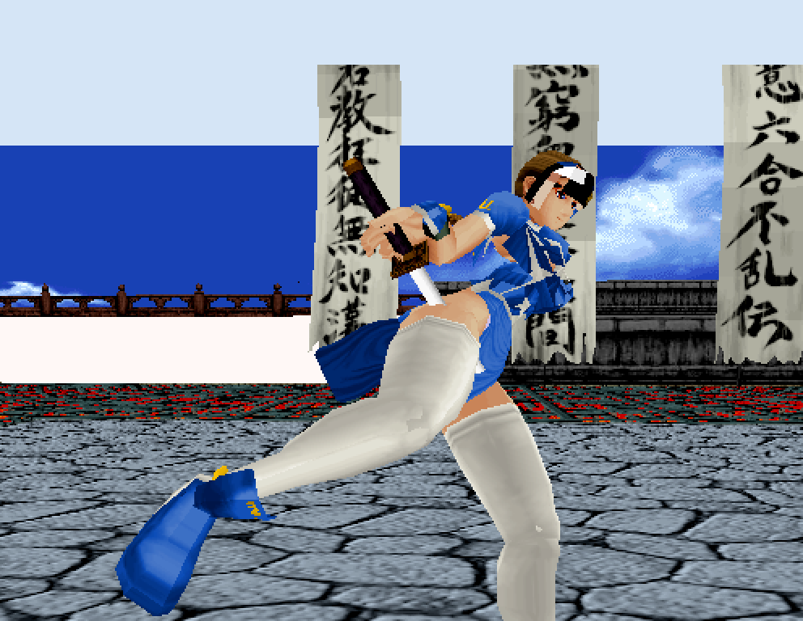

# SAGE — Sega Arcade Golden-era Emulator

A modern C++20 emulator project. The first target is **Dead or Alive** on Sega
**Model 2B** hardware (i960 main CPU + 315-5881 GPU + SCSP sound).

Current status: Dead or Alive boots, the dual-CPU (i960 + ADSP-21062 SHARC)
pipeline runs with FIFO backpressure, the System 24 2D tilemap/text layers
render, and the 3D engine rasterizes textured characters and arenas at 60 FPS.
The Yamaha YMF292-F (SCSP) + 68EC000 sound board is implemented. See
[`ROADMAP.md`](ROADMAP.md) for the milestone list.

## 📸 Screenshots



## Layout

```
SAGE/
├── CMakeLists.txt          C++20 build, FetchContent miniz
├── include/sage/
│   ├── rom_loader.h        RomLoader interface
│   ├── types.h             Region / RomVerify / LoadReport
│   ├── bus.h               Model 2B memory interconnect
│   ├── geometry.h          Model 2 3D geometry + rasterizer
│   ├── video.h             System 24 2D tilemap / palette / scanout
│   ├── display.h           SDL2 window / present
│   ├── cpu/                i960, m68000 (68EC000), sharc
│   └── hw/                 SCSP, SCSP DSP, i8251, sound board
├── src/
│   ├── main.cpp            CLI, status tables, boot trace, frame loop
│   ├── rom_loader.cpp      ROM table + load/verify implementation
│   ├── bus.cpp             address decoding + RAM/ROM
│   ├── geometry.cpp        display-list parse + scanline texture rasterizer
│   ├── video.cpp           2D tilemaps + palette decoding
│   ├── cpu/                i960, m68000, sharc cores
│   └── hw/                 sound_board, scsp, scsp_dsp, i8251
├── scripts/fetch_assets.sh downloads references (no ROMs)
├── references/             MAME sources + Supermodel (git-ignored)
└── roms/                   doa.zip (git-ignored, user-supplied)
```

## Fetching assets

```bash
./scripts/fetch_assets.sh      # or: cmake --build build --target fetch-assets
```

This pulls the MAME Model 2 driver sources and a shallow clone of Supermodel
(architecture reference). It does **not** download game ROMs: Dead or Alive is
copyrighted material, so supply your own legally obtained `doa.zip` (a
MAME-compatible `doa` set) at `roms/doa.zip` before running.

## Build and run

```bash
cmake -B build -DCMAKE_BUILD_TYPE=Debug
cmake --build build
./build/sage                          # optionally: ./build/sage <zip> <doa|doab> [instructions]
```

The loader prints each ROM IC with its verified CRC32, the mapped memory
regions, and the program memory range. It then resets the i960, prints the boot
vector (SAT/PRCB/IP read from 0x00000000), and steps the CPU for 1000
instructions with a disassembled trace of the first 20 and a checkpoint every
200.

## CPU core

`src/cpu/i960.cpp` is a standalone port of MAME's `src/devices/cpu/i960` core
(BSD-3-Clause, Farfetch'd / R. Belmont) with the MAME device framework removed:
the `memory_access<>` cache is replaced by a `BusInterface`, `fatalerror()` by a
recoverable `Fault` exception, and state registration / `save_item` dropped.
Instruction semantics are kept verbatim so traces match MAME's.

`Bus` (src/bus.cpp) decodes the subset of `model2b_0229_mem()` the boot path
touches: program ROM at 0x00000000, `main_data` ROM at 0x02000000/0x06000000,
work RAM, buffer/palette/texture/luma RAM, and the CPU-control register block at
0x00e00000. Unmapped accesses are counted and return 0 rather than faulting.

## Notes

- ROM files are resolved inside the archive **by CRC32 first**, then by
  filename. The archive's sound ROM and two sample ROMs are stored under labels
  that differ from MAME's, so CRC matching is required.
- The Internet Archive `doa.zip` contains the **Revision B** program ROMs, so the
  loader auto-detects the revision and reports it.
- `mpr-19324.19` is present as dump `D972201F` (documented in the m2emu 1.1a DAT),
  which is accepted as a known alternate of MAME's `0D6BF454`.
- Region contents are byte-swapped after loading, matching MAME's
  `region_post_process()` (visible in the big-endian `samples` region).
